# SmartBank Malaysia — Database Security Architecture & Implementation

**A defence-in-depth Microsoft SQL Server security case study covering confidentiality, integrity, availability, and evidence-based control validation.**

   

## Overview

SmartBank Malaysia is a simulated digital banking database used to design, implement and evaluate layered database security controls. The initial schema contained banking tables but lacked comprehensive authentication, role separation, record-level restrictions, encryption, auditability, and recovery safeguards.

This project redesigned **SmartBankDB** around the **CIA triad** using Microsoft SQL Server, with a documented test plan of **45 positive and negative tests** and a **15-minute recovery point objective (RPO)**. The work was conducted in a controlled academic environment; it is not a production banking deployment.

> **Project attribution:** This is a **Group 20** assignment for *CT069-3-3 Database Security* at Asia Pacific University. Contributors: **Ahmed Ali Shagea, Immanuel Milad Moawad Indrawes, Fairouz Abdulrahman Hamed Mousa, and Odai Adel Abdulrahman Rashed**. The repository presents the group's documented implementation and does not attribute all work to one person.

## Project at a glance

| Area | Implementation |
|---|---|
| Database | Microsoft SQL Server 17.0 Enterprise Developer Edition; SQL Server Management Studio |
| Identity | SQL Server logins, database users, `PrincipalMap` |
| Authorization | Role-based access control (RBAC), least privilege, native row-level security (RLS), security views |
| Data integrity | Foreign keys, CHECK/DEFAULT constraints, controlled stored procedures, atomic transactions |
| Data protection | AES-256 column encryption, encrypted backups, dynamic/static masking, SHA2-256 pseudonymization |
| Accountability | AuditLog, DML/DDL triggers, SQL Server Audit, permission-change auditing |
| Recovery | Full recovery model, automated full/differential/log backups, verification, standard restore and PITR |
| Validation | 45 documented tests across security and availability controls |

## Security architecture

The security model follows seven complementary layers:

1. **Identity:** authenticate principals and map them to staff or customer records.
2. **Authorization:** enforce roles, secure views, procedures, and restrictions on direct table access.
3. **Validation:** prevent inconsistent data using database constraints.
4. **Controlled transactions:** perform banking operations through role-aware, atomic procedures.
5. **Accountability:** capture activity through application-level and SQL Server auditing.
6. **Encryption:** protect sensitive columns and backup media using SQL Server key/certificate controls.
7. **Resilience:** schedule, verify, and test backups and recovery.

## 1. Authentication, RBAC and row-level restrictions

Roles represent database administrators, bank managers, bank officers, and customers, with a shared authenticated-access role. A `PrincipalMap` links a database principal to a staff or customer identity. Customer views filter by the current database identity using `USER_NAME()` rather than trusting a user-provided customer identifier. Native RLS provides an additional engine-enforced boundary for customer records.

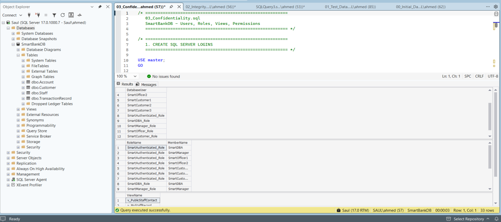

*Evidence: SQL Server database users, roles and memberships (report p. 25).*

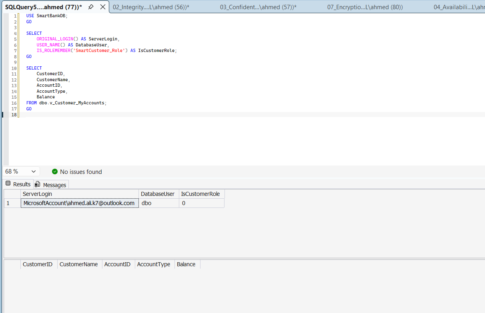

*Evidence: customer authentication and authorization context (report p. 26).*

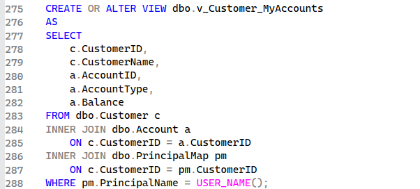

*Evidence: principal-aware customer account view (report p. 28).*

## 2. Transaction integrity and controlled operations

The design uses foreign keys and domain constraints to protect account relationships, balances, and transaction values. Stored procedures govern banking operations. Transfers use explicit transaction handling so a failed operation does not leave only one side of a transfer applied.

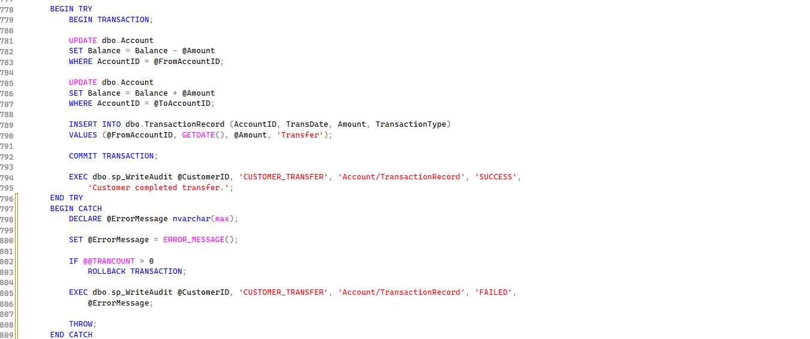

*Evidence: transaction-safe transfer logic and error handling (report p. 35).*

## 3. Encryption, masking and privacy

Sensitive fields, including salary and national identifiers, are protected using SQL Server's database master key, certificates, and AES-256 symmetric encryption. The project also implements dynamic and static data masking, SHA2-256-based pseudonymization, and identifier-free analytical outputs. These are distinct controls with different security purposes.

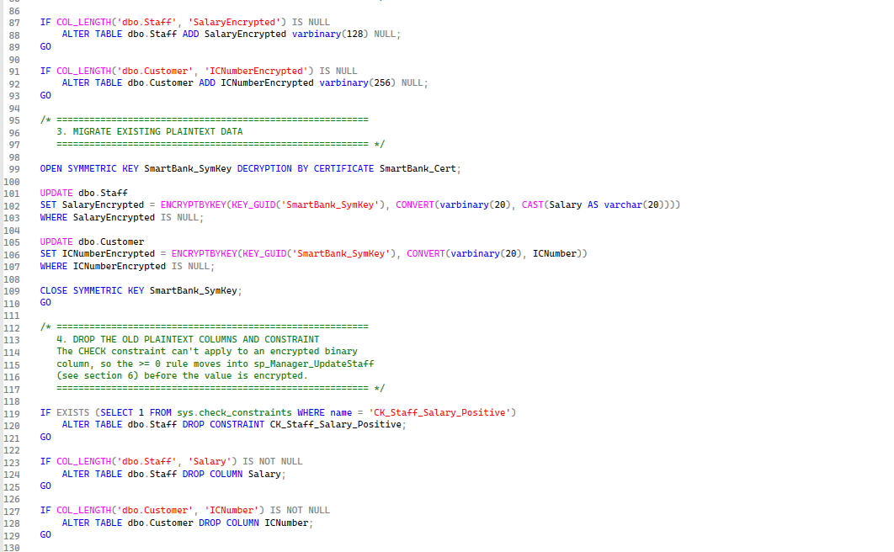

*Evidence: database encryption hierarchy (report p. 42).*

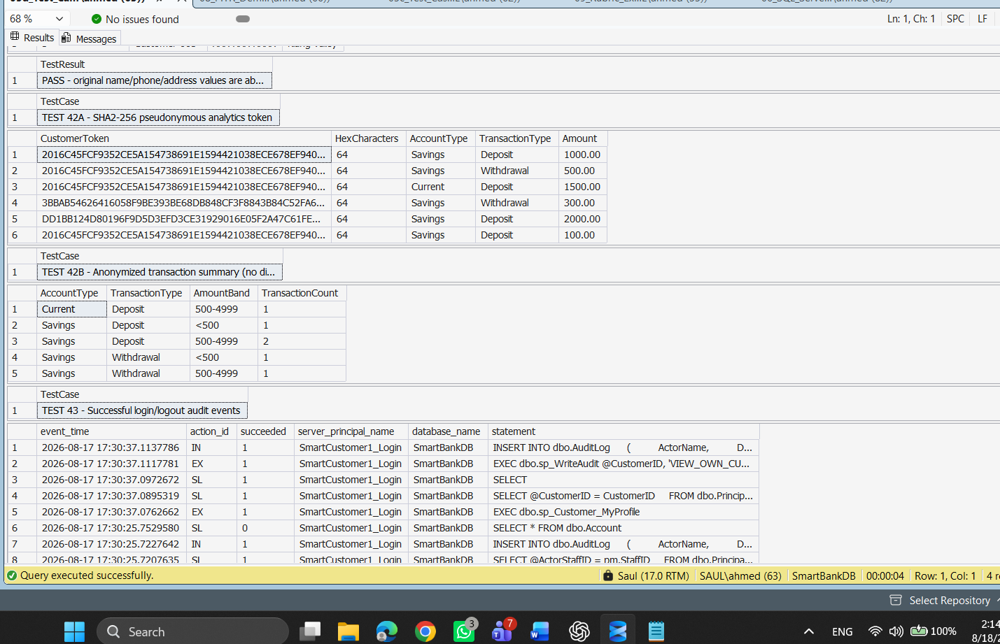

*Evidence: privacy-control test results (report p. 67).*

## 4. Security auditing

A layered audit strategy combines a database `AuditLog`, DML/DDL triggers and SQL Server Audit. The documented scenarios cover successful and failed access, data modification, schema changes and permission changes.

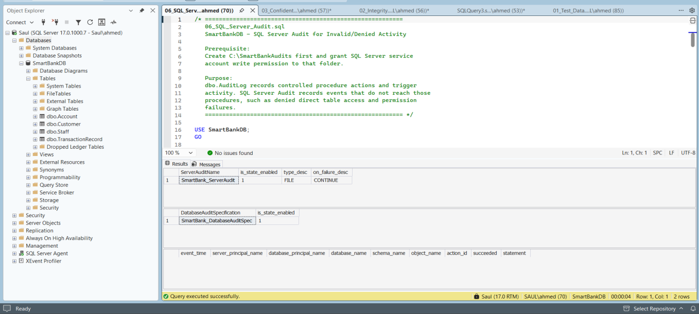

*Evidence: audit configuration and file access (report p. 38).*

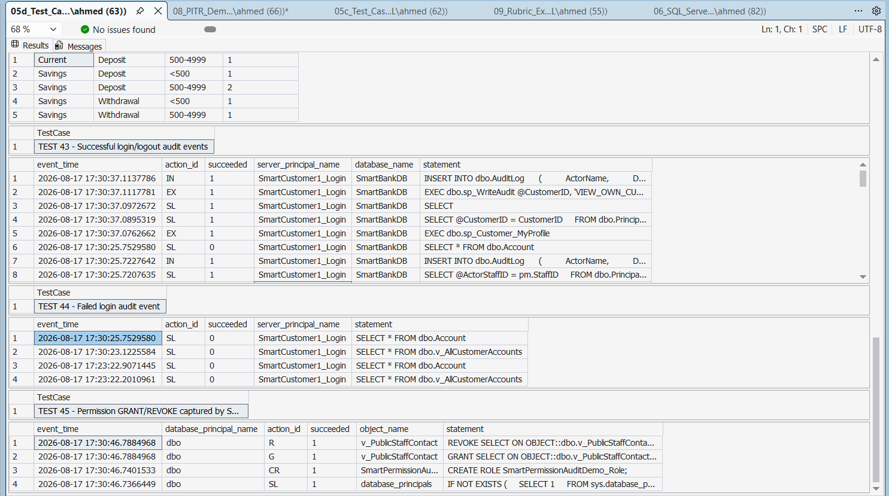

*Evidence: SQL Server Audit results for failed activity and permission changes (report p. 68).*

## 5. Automated encrypted backup and recovery

The database uses the **FULL** recovery model and an RPO target of **15 minutes**, supported by scheduled transaction-log backups alongside full and differential backups. The report documents AES-256 encrypted backup procedures, `RESTORE VERIFYONLY`, standard restoration and point-in-time recovery using `STOPAT`.

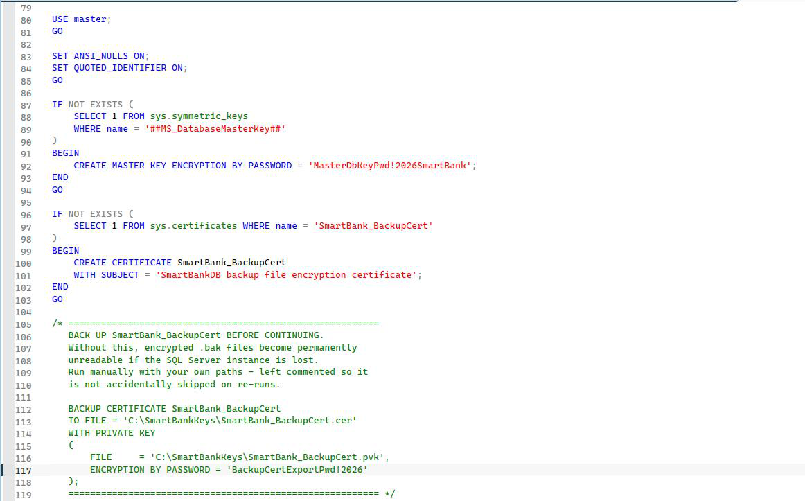

*Evidence: backup encryption (report p. 46).*

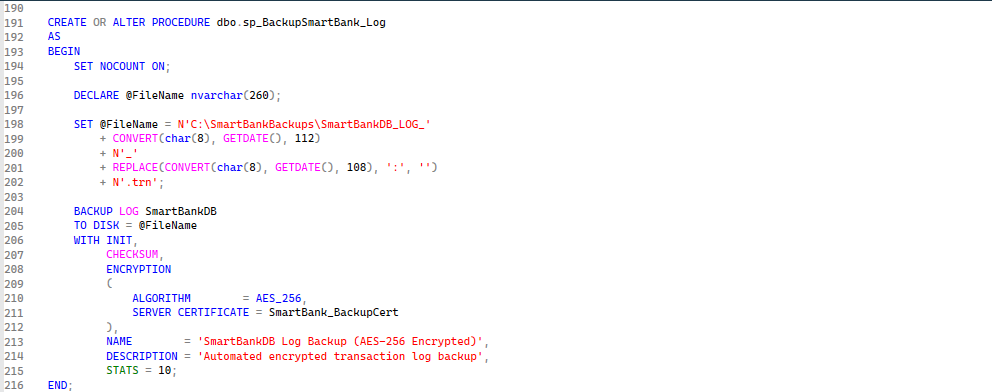

*Evidence: scheduled encrypted transaction-log backup procedure (report p. 50).*

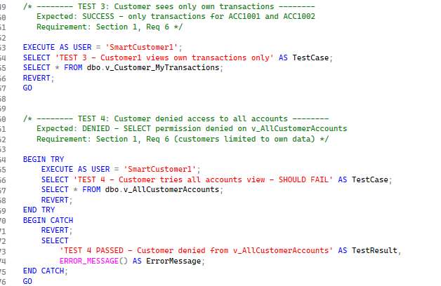

*Evidence: backup validation and restore testing (report p. 53).*

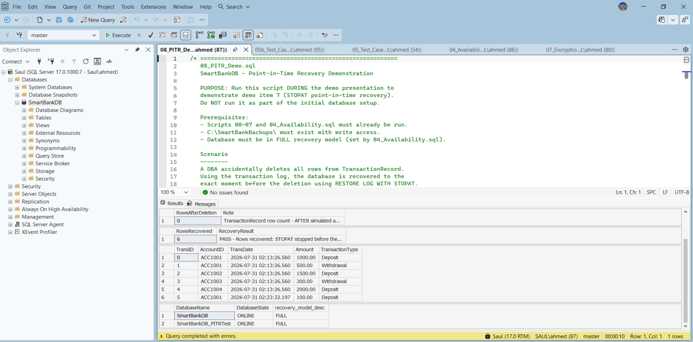

*Evidence: point-in-time recovery and restored records (report p. 55).*

## 6. Security testing and results

The report documents **45 test cases**, including permitted/denied access, customer data isolation, transaction constraints, encryption, masking, audit capture, backup validation and recovery. The methodology includes both positive and negative tests, rather than relying on configuration screenshots alone.

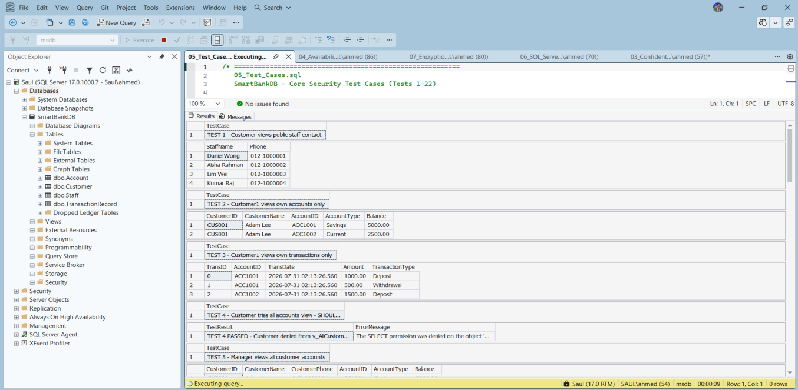

*Evidence: confidentiality and integrity test output (report p. 59).*

For the complete testing matrix, control explanations, implementation references and limitations, see the [full project report](SmartBank-Database-Security-Report.pdf).

## Technology and tools

- Microsoft SQL Server 17.0 Enterprise Developer Edition
- SQL Server Management Studio (SSMS)
- T-SQL, stored procedures, views, triggers and security policies
- SQL Server Audit and SQL Server Agent
- SQL Server encryption and backup/restore facilities

## Scope and limitations

This is an **academic database-layer security implementation**, not a live financial service. The report notes that a production rollout would additionally require secure credential rotation, stronger centralized identity/MFA, protected key custody, off-host backups, operational monitoring, and tested recovery procedures. The screenshots and report document the implemented lab controls; the original SQL script files were **not included in the supplied PDF** and are not presented here as executable source.

## Repository contents

- `README.md` — project overview and implementation evidence
- `SmartBank-Database-Security-Report.pdf` — full 74-page assignment report
- `*.png` — 13 screenshots extracted from the report, referenced directly from the repository root

## Academic context

**Module:** CT069-3-3 Database Security  
**Institution:** Asia Pacific University of Technology & Innovation (APU)  
**Project:** SmartBank Malaysia database security case study  
**Assignment:** Group 20

---

*All images are evidence extracted from the submitted academic report. This repository is intended to showcase database security design, implementation and testing practices.*
